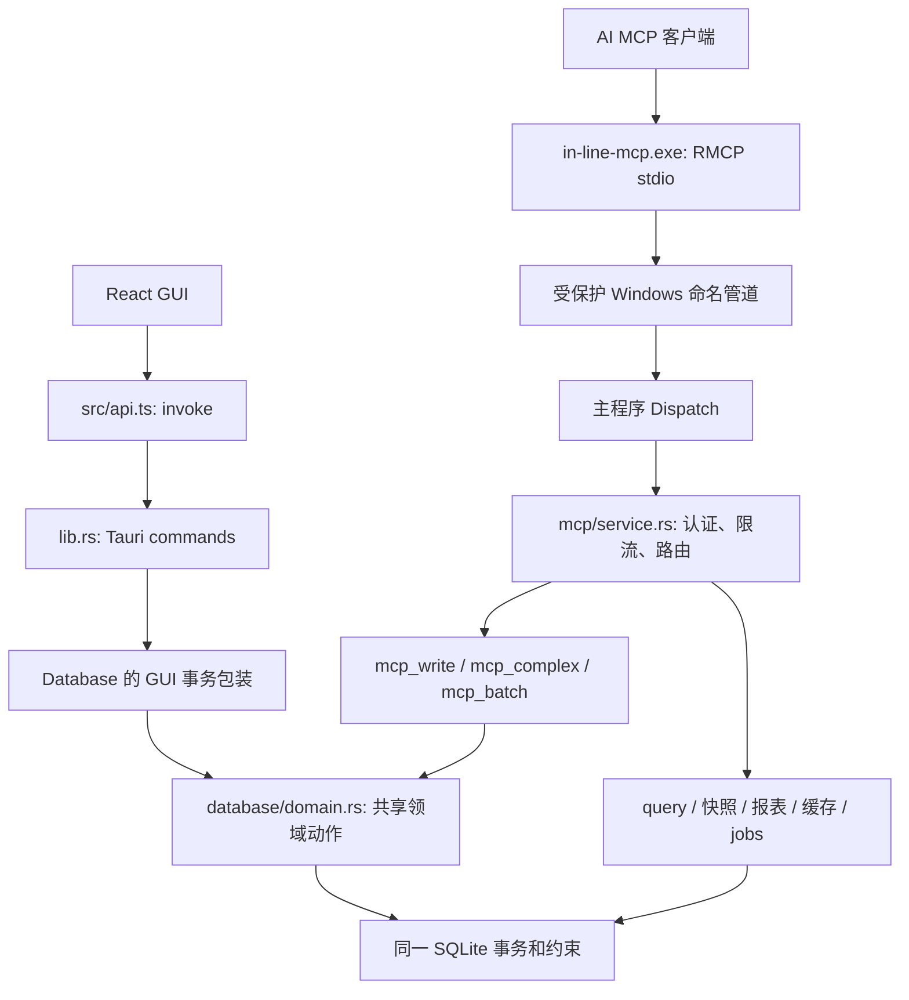
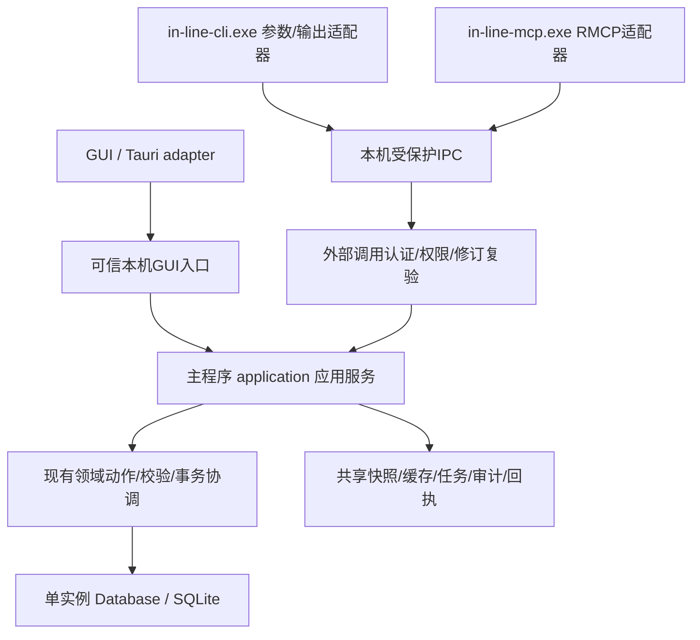

# GUI、CLI、MCP 统一架构：Phase 0 调查与已确认方案

日期：2026-10-16。状态：**Phase 0 方案已由用户确认；D1–D4全部选A，尚未进入开发**。

用户确认原文：“A：D1–D4 均选报告推荐的 A，确认 Phase 0 方案”。此次确认仅针对方案，不自动进入 CLI Phase 1。按本任务阶段规则提交推送这两份文档后停止；不将此确认解释为业务代码、安装、数据操作或发布授权。

本报告与 [CLI 命令草案](COMMANDS-DRAFT.md) 一起交付。这里的 CLI 命令、目录和新接口均为提议，不能当作已经存在的功能。

## 1. 范围、基线和执行边界

- 输入：用户粘贴的《In-Line 项目 CLI 与 MCP 统一架构开发任务》；本轮仅执行其 Phase 0。
- 实际仓库：`D:/codex-data/projects/inline/In-Line`；远端 `https://github.com/bluntvoice/In-Line.git`。
- 分支：`feat/scheduled-items`；HEAD：`43a1e888c8d07e92aef18075168dfda244126cb4`。
- 已执行 `git fetch origin --prune --tags`；本地与同名远端 ahead/behind 为 0/0，无需拉取或合并。开始时工作区干净。
- `origin/main`：`1baac96252af2665274f2a955b3adacfa80519fd`；开发版本 0.5.0 不代表正式发布。
- 调查及本次确认只新增本目录两份文档。不修改代码、数据库、凭证、已安装程序、版本、MCP 契约或工作流；不启动额外服务、不运行生产业务调用。调查交付时未提交；用户确认后按阶段规则仅提交推送本目录两份文档。
- CLI 阶段记为 **CLI Phase 0–6**，与原 MCP P0–P9 分开。原 MCP P1–P8 尚待统一验收，不因本报告通过而获得验收。
- 本次 CLI 任务采用新的“每阶段用户验收 → 提交推送 → 下一阶段”规则；此前针对 MCP 的统一验收/开发提交授权不自动扩展到 CLI。

## 2. 核心结论

现有架构适合增量增加 CLI。业务规则已有较多复用，最小方案是新增一个 Rust 控制台入口，通过现有受保护本机 IPC 调用唯一主程序协调者；GUI、CLI、MCP 在协调者中复用应用服务和领域事务。CLI 不直接打开业务库，也不需要经过 MCP stdio。

需要补齐的是应用服务边界、外部调用上下文、结构化错误适配和 CLI 授权接入，而不是再实现一遍事项管理。首轮不拆 Cargo workspace，不把整个数据库模块搬家，不将现有 16 个工具重命名为通用接口。

CLI 可避开“当前 Codex MCP 传输关闭”这一入口依赖，但**仍须有效独立授权**；不能把调用本机程序等同于拥有全部权限，也不能借 CLI 绕过软件内批准。

## 3. 已核实的技术栈和调用链

### 3.1 技术栈

| 项目 | 代码事实 |
| --- | --- |
| GUI | React 19、TypeScript、Vite 7；Tauri 2；Windows WebView |
| 后端 | Rust 2021 edition，单 Cargo package；`in_line_lib` rlib |
| 现有入口 | `in-line.exe` 图形程序、`in-line-mcp.exe` RMCP stdio sidecar；没有正式业务 CLI |
| 持久化 | rusqlite 0.37，bundled SQLite；业务 schema 14，`schema_meta` 记录版本 |
| 并发 | 共享 `Database` 中的 `Arc<Mutex<Option<Connection>>>`；主程序单实例/命名管道协调 |
| 运行时 | Tokio；RMCP 3.1.2；命名管道、DPAPI、安全描述符采用 Windows API |
| 注入方式 | Tauri `State<Database>`、`Arc<Security>`、闭包 Dispatch；没有独立依赖注入框架 |
| 验证/构建 | Vitest、Rust 单元/集成、真实 stdio/IPC 测试、Node 浏览器检查脚本；Windows CI 和 NSIS |
| 平台边界 | 多个安全/服务模块有 `cfg(windows)`；现有 CI 只证明 Windows，不能声称已经支持 Linux/macOS |

依据：[Cargo.toml](../../src-tauri/Cargo.toml)、[package.json](../../package.json)、[CI](../../.github/workflows/ci.yml)、[模块注册](../../src-tauri/src/mcp/mod.rs)。

### 3.2 当前实际调用关系

1. GUI 的 [src/api.ts](../../src/api.ts) 调用 `lib.rs` 中的 Tauri 命令，后者调用 `Database`；并非 GUI 调用 MCP。
2. [sidecar](../../src-tauri/src/bin/in-line-mcp.rs) 负责工具注册、参数反序列化、当前凭证解析和协议封装，业务执行交给命名管道，不直接管理正式库。
3. [lib.rs](../../src-tauri/src/lib.rs) 建立主程序状态和 IPC Dispatch，将调用交给 [mcp/service.rs](../../src-tauri/src/mcp/service.rs)；同时处理前端数据变更通知、操作提醒等宿主职责。
4. [ipc.rs](../../src-tauri/src/mcp/ipc.rs) 包含用户私有管道、拒绝远程客户端、挑战/HMAC、包长/期限限制、并发控制、调用前认证及结果释放前授权修订复验。只搬走 `service::execute` 而漏掉这些外围保护并不等价。
5. `database/domain.rs` 已提取创建/编辑、状态、加急、办理事件、队列、子任务和组操作。GUI 与 MCP 的主要写入已进入同一领域函数；并不是所有 GUI 功能都已共享同一应用服务。

### 3.3 事务、编号、统计和缓存

- `Database::with_conn`（database.rs:616）串行借用连接；GUI 事务包装和 `mcp_transaction` 分别拥有事务。领域函数接收事务内 Connection，不自行提交。
- `mcp_transaction`（database/mcp_write.rs:530）在同一数据库互斥锁内执行、提交并独立回读版本；提交不明与核验失败不能包装成正常成功。
- MCP 写入另有明确意图、字段原值/版本、幂等回执、审计、撤销申请及限域。GUI 普通日志不等于完整 MCP AI 审计，不能声称两入口审计已经完全一致。
- 编号、轮次、改期及未来事项处理在 `database.rs` 辅助函数和 `database/domain.rs`；CLI 应复用事务内动作。A/B/C 是跨日编号显示，不是办理轮次。
- schema 11 起的数据库触发器在 GUI/领域/导入事务中共同更新数据基准，schema 14 已有增量索引及健康检查。不能只在 CLI 后手动“清缓存”代替事务内变化记录。
- 查询使用受限内存 SQLite 快照；cursor 绑定客户端、权限/范围、条件和数据基准。快照、后台任务、增量和缓存状态由主程序持有，CLI 进程退出后不应丢失这些共享状态。
- 报表/日历以真实有效办理事件及现有统计规则为准；范围内每事项最后有效结果、当前属性归属等规则不能被 CLI 的日期过滤或去重重新定义。

依据：[领域函数](../../src-tauri/src/database/domain.rs)、[数据库](../../src-tauri/src/database.rs)、[写入及回执](../../src-tauri/src/database/mcp_write.rs)、[数据基准](../../src-tauri/src/database/mcp_read.rs)、[查询](../../src-tauri/src/mcp/query.rs)、[未来事项 PRD](../prd/future-items.md)、[子任务 PRD](../prd/subtasks.md)、[工作日历 PRD](../prd/work-calendar.md)。

## 4. 功能映射：当前事实与 CLI 优先级

记号：**实**=代码及既有自动化证据；**部**=部分已有，新增适配仍需实现；**设**=本报告设计；不代表用户实机验收。CLI 优先级按拟定 Phase 列出。

| 功能 | GUI 实现 | MCP 实现/状态 | 核心位置及复用情况 | CLI 阶段 / 重构风险 |
| --- | --- | --- | --- | --- |
| 帮助、版本、doctor/status | GUI 版本/初始化 | get_capabilities 实；无离线 doctor | build_identity、contract；本地检查器需新增 | 2 / 低 |
| 事项列表、精确读取、搜索 | list_tasks/get_task，前端筛选 | query_tasks 实 | query.rs + Database；权限/快照可复用；CLI 解析/展示设 | 3 / 中 |
| 组合过滤、投影、分页 | GUI 筛选/列布局 | QueryFilters/QueryArgs 实 | ids/编号/状态/部门/类型/优先级/工作量/日期/父子/回收站等；单页≤100 | 3 / 中 |
| 自定义排序 | GUI 队列/子任务排序 | 查询参数无通用 sort 字段 | 初版沿用底层稳定顺序；任意跨页排序仅设 | 不首批新增 / 中 |
| 时间线、队列/办理历史 | get_logs/get_work_events | query_task_history 实 | query.rs + 原历史表；无权自由文本不能流出 | 3 / 中 |
| 日历、统计、报表 | work_calendar/statistics/details | query_work_calendar/get_report_summary/list_report_items 实 | 共享统计函数及快照；参数/封装并未完全统一 | 3 / 中 |
| 四字段日报文本 | GUI 无对应固定命令 | 现有报表数据，指定文本格式未实现（部） | 新的共享只读报表组装/呈现；对接人需 fullRead；同快照 | 5 / 中 |
| 创建、局部编辑 | save_task | mutate_task create/patch 实 | domain::save_task_on；MCP 补版本/审计/幂等 | 4 / 高 |
| 状态、完成、加急 | set_status/complete_task/set_urgent | setStatus/setUrgent 实；父任务显式完成范围接口不完全相同（部） | domain.rs；MCP直接完成有未完子任务时拒绝，GUI有显式组完成包装，需受权应用服务适配 | 4 / 高 |
| 真实办理/轮次 | process_round/complete_round | recordWorkEvent、Queue 模式实 | 同一办理事件及轮次函数；需要真实办理确认 | 4 / 高 |
| 未来事项及改期 | save/enqueue/reopen、自动到期 | reschedule/queue 实 | 不回收号码、提前取今日号、补入保原号；不重写 | 3读/4写 / 高 |
| 今日队列与顺序 | list_tasks/move_task | query_tasks/queue moveUp/Down 实 | 活动队列与子任务排序分离；不能按 plannedDate=今天代替今日队列 | 3读/4写 / 高 |
| 父子查询/候选 | list_subtasks/parent_candidates | parent/structure 过滤实；候选列表需限域适配（部） | Database 现有 GUI 查询不能原样当无权限 CLI 查询 | 3读/4写 / 中 |
| 子任务创建、挂接、更换/解除、排序 | create_subtask/set_parent/reorder | CreateSubtask/SetParent/ReorderSubtasks 实 | domain.rs，两级/无环/继承后独立 | 4 / 高 |
| 受控归档 | 后端兼容；GUI独立按钮已取消 | Archive 实，C1批准 | archive_task_group_on_domain；CLI 不恢复 GUI 按钮，不用完成替代归档 | 4 / 中 |
| 回收站、恢复 | soft_delete/restore/group | Trash/Restore 实 | domain.rs；恢复回收站与重新开启归档是不同动作 | 4 / 高 |
| 永久删除/清空回收站/合并 | GUI 有 | MCP 不支持永久删除；无 merge TaskAction | 保留 GUI 既有边界，不因有 GUI 方法就开放给 CLI | 本轮排除 / 高 |
| 普通偏好 | set_setting | manage_preferences 白名单实 | 现有偏好/冲突机制可复用；不包括安全配置 | 5 / 中 |
| 单事项编号配色 | set_task_ticket_color | 查询可返回 ticketColor；未见对应写入 TaskAction（部） | 不伪装为 CLI 已可写；将来需专门评估 | 延后 / 中 |
| 批量预演/原子执行/改期确认 | 软件内批次审批 | batch_mutate 实 | mcp_batch.rs，共享领域动作；默认20、硬限100 | 5 / 高 |
| 命名查询 | 管理能力偏 MCP | manage_saved_query 实 | query.rs；save/delete 也要写权限和明确指令 | 5 / 低 |
| 增量变化 | GUI 变更事件/派生基准 | query_changes 实 | changes.rs/mcp_changes.rs；先全量再增量，游标失效不猜补 | 5 / 中 |
| 后台查询/导出、等待/取消/恢复 | GUI jobs 管理 | manage_jobs 实 | jobs.rs；不是业务写入调度器，资源和期限不另建 | 5 / 高 |
| 数据健康、统计溯源、缓存 | GUI health/cache | inspect_data 实 | inspect/query/cache/quality；不授权 CLI 修复业务原始数据 | 3基础/5高级 / 中 |
| 备份/受限导出 | GUI 完整备份与恢复 | manage_business_data backup/export 实 | business_data/mcp_artifacts；返回受控本地产物引用 | 5 / 高 |
| 覆盖恢复、任意文件/SQL、附件 | GUI 部分有 | 明确不支持 | 不进入 CLI；不得以 shell 插件恢复这些能力 | 排除 / 高 |
| 审计、撤销 | GUI 审阅及批准/拒绝 | request_undo 实；AI无批准接口 | mcp_write；CLI只申请，原回执只读核验尚需服务接口（部） | 4 / 高 |
| 自身诊断、维护 | GUI 故障/审计预览确认 | get_diagnostic 实 | diagnostics/maintenance；CLI只读自身错误，维护审批留软件内 | 3诊断/5完善 / 中 |
| 授权、轮换、暂停/撤销 | 主窗口安全管理 | 全部工具需认证；接入刷新代码/隔离验证实 | security/onboarding/runtime_credentials；CLI授权适配未实现 | 2–3 / 高 |

### MCP 未完成项的明确区分

- **已实现且有既有自动化证据**：16 工具声明、受权查询/写入/批次/后台任务/增量/健康/诊断机制；最新既有证据为 177 Rust、119 前端测试。这里只核对日志，未为文档改动重跑这些测试。
- **部分完成、实机待验**：Codex 首次授权/导入/绑定运行态凭证刷新；同一 stdio 隔离回归已通过，不能替代当前挂载工具成功。
- **最近安装记录**：本轮开始前的安装证据为 schema14、310事项/23表保留；停止旧 sidecar 后当前挂载记录为 Transport closed，本次调查未重测或修改连接。
- **仅设计**：本报告全部 CLI 命令、CLI身份/安全接入、统一 application façade、CLI 跨入口一致性测试、CLI 安装/PATH 策略。
- **不在已确认范围**：MCP P9/正式发布、任意写入调度、远程服务、跨平台完整支持，不据旧设计文字自动实施。

代表性差异：GUI `complete_task_on_domain` 接收明确的子任务范围，而 MCP `SetStatus(completed)` 走 `ensure_direct_completion_allowed`，存在未完成子任务时拒绝。不能写成“CLI复用SetStatus即已支持GUI全部完成选择”，也不能在客户端分步修改模拟原子组完成。Phase4需要把显式完成范围作为应用服务请求，补所有相关事项的授权/版本/事务检查；MCP现有直接状态动作仍保持原保护。如要给MCP新增同等范围参数，必须先获得协议兼容方案批准。

依据：[16工具基线](../mcp/contracts/tools-v1.json)、[TaskAction](../../src-tauri/src/mcp/write_types.rs)、[查询参数](../../src-tauri/src/mcp/query_types.rs)、[接入和安装报告](../mcp/acceptance/P8-FIRST-AUTHORIZATION.md)、[当前会话安装后记录](../mcp/acceptance/evidence/P8-onboarding-current-session-after-install.json)。

## 5. 建议目标架构和最小迁移

### 5.1 代码安排（提议，尚未创建）

| 模块 | 建议动作 | 原因与约束 |
| --- | --- | --- |
| `src-tauri/src/application/` | 新增薄应用服务：先查询与代表性状态动作；逐步统一上下文和结果 | 只移入口协调，不复制领域 SQL；不建通用框架或 DI 容器 |
| `mcp/service.rs` | 保留原接口作兼容 façade，内部逐项委托应用服务 | 不改 16 工具名字、参数和原有返回语义 |
| `mcp/ipc.rs` | 首版复用受保护传输和现有操作路由 | 新 CLI 专用只读回执/健康操作须独立白名单及版本协商，不把字符串当任意命令 |
| `bin/in-line-cli.rs` + `cli/` | Rust 控制台入口，解析、JSON/table、退出码、受权 IPC client | 不带 GUI Windows subsystem；不调用 shell、不启动 MCP 子进程、不打开业务库 |
| `database/domain.rs` | 保留为当前共享业务核心 | 不因目录命名不够“分层”就整体迁移；必要 helper 逐项提取 |
| `database/mcp_write.rs` / complex / batch | 先复用，逐步将协议无关协调放到 application | 保留原回执 fingerprint、审计及事务；不全表改名或重生成幂等键 |
| query / changes / jobs / cache / diagnostics | 复用同一主程序实例，适配公共类型时保留旧 re-export | CLI 不各建缓存、任务队列或快照注册表 |
| `lib.rs` | Tauri/宿主适配；把通知、请求跟踪与结果复验集中为公共入口钩子 | CLI 写入也须刷新 GUI；只移 execute 会丢这些行为 |
| security / onboarding / runtime_credentials | 保留安全域，新增明确 CLI 适配能力后再开放 | 现有可信 Codex/sidecar 二进制绑定不能直接泛化成任何 CLI 都可继承 |
| Cargo/打包/CI | 后续加入 CLI binary、兼容检查和测试 | 初版单 package；是否引入成熟命令解析库在 Phase2 审查锁定，不更新本轮依赖 |

### 5.2 执行边界

业务调用必须走：解析和白名单 → 可信来源及独立身份 → 权限/范围/限流 → 统一应用服务 → 同一事务内版本/业务校验、审计和回执 → 提交回读 → 授权修订复验 → 格式化输出。

- `CallContext` 建议记录 requestId、真实入口来源、principal、授权修订及用户意图；不由 CLI 自报 `trustedGui=true`。GUI 本地人工动作与外部客户端身份不同，不把全局 MCP 暂停施加到 GUI 普通操作。
- 同一业务应复用同一规则和变更结果，但 GUI 本地人工入口与外部入口可以保留不同认证和确认方式。统一业务层不意味着给所有入口开放 GUI 的全部管理权限。
- Phase1 先让一个查询和一个状态动作通过同一 façade；其他已有 GUI 路径继续调用相同 domain，后续按需求迁移。不把整个 GUI 一次改走 MCP 的 JSON dispatcher。
- 保持现有安全锁/DB锁次序和返回前复验；包括幂等重放也重新校验当前权限。保持 GUI 变更通知及技术观察钩子。
- 初版无需业务 schema 变更。若真实入口来源不能从现有审计字段/关联记录表达，先单独提交 schema 与备份迁移方案，不能在“清理命名”时夹带迁移。

## 6. CLI 与 MCP 的兼容、安全、权限

1. CLI 是新的外部适配器，不天然属于管理员；默认同样为常规读取、fullRead/write 双方交集及部门 AND 类型范围。CLI 不读授权密文以外的“万能数据库入口”。
2. 建议首版为 CLI 独立授权身份，自动化按所选客户端/用途隔离。GUI 生成短期加密包，CLI 本地导入并验证；长期凭证不进聊天、提示词、参数或普通日志。导入及权限管理不由 CLI 自行授予。
3. 新增 CLI 客户端类型、一次性包用途及凭证供应适配是**待开发**。现有 `require_authorization_available` 只接受 Codex；当前 Provider 绑定 Codex进程和sidecar二进制，不能换名字直接复用。
4. 人工 PowerShell 与 Codex 调用 CLI 不默认共用身份；配置选择须明确，不能自动回退到权限更大的身份。不新增“同一 Windows 用户即全权限”模式。
5. 所有外部写入需要显式执行、理由、用户意图、稳定幂等键和必要版本条件。`--execute` 不能替代完整权限、真实办理确认、敏感风险提示或软件内审批。
6. 退出和重试策略以提交状态为准。未知提交结果/授权变化/后置核验失败禁止盲重放、禁止换键；新增只读回执核验应先查账本，未找到也不能转为执行原写入。
7. 多事项改期和撤销仍由软件内批准。CLI 返回 pending 与引用，不能提供 `approve`、`--force` 或 `--yes` 绕过服务端审批。
8. 常规查询不包含联系人、详情和办理自由文本；四字段日报含联系人，必须启用有效 fullRead。CLI 的 table、text、JSON 适用同一投影规则。
9. 保留 MCP API v1 的工具及完整 schema/注解基线。内部服务重构前后运行现有契约门禁；CLI 只读回执等新增内部能力不偷偷增加/替换 MCP 工具。必须改协议时先交兼容性说明。
10. 日常命令可以沿用 IPC 按需后台启动主程序，保留单实例门禁；`doctor` 默认不启动主程序、不打开/迁移业务库、不修复安全配置。初版不支持无 Tauri 宿主的独立生产数据库写入。

## 7. 日报口径需要确认

用户指定的文本为 `YYYY-MM-DD 今日计划完成事项`，逐项 `事项类型-事项标题-事项对接部门-事项对接人`；但同时要求按现有“已处理/已完成”口径。

这两种语义不能默默混合。建议 D4-A：保留指定标题，但明确它是**指定日实际办理回顾**；采用现有报表按范围内每事项最后有效结果计一项及已处理结果集合，作废事件不算，父子独立，不能用当前状态或 plannedDate 推测完成。文本附口径说明，不将未来计划称作已完成。

联系人等字段按当前授权属性在同一冻结快照中读取；现有报表输出不必然有四个字段，需要服务端统一组装，不拼接多次 live 查询。无 fullRead 时四字段文本明确拒绝；可另显式选择不含联系人的普通报表，不以静默空值假装完整。

周/月边界、时区、计划/办理/完成统计模式均从统一服务或已有偏好解析；文本渲染只负责格式，不重新计算指标。

## 8. 阶段计划和独立验收标准

| CLI 阶段 | 独立范围 | 必须验证与停止条件 |
| --- | --- | --- |
| 0 调查 | 本报告、映射、命令/错误草案、决策 | 文件/链接/基线和不改代码检查；等待用户确认，不提交/推送、不进入1 |
| 1 服务边界 | 一个受权查询和代表性状态动作；GUI/MCP façade 共用 domain/事务和宿主钩子 | 合成库比较行为、冲突/回滚/编号/统计/通知；现有16工具完整契约不变；先补差异回归；阶段验收后才提交推送 |
| 2 CLI基础 | 控制台入口、帮助/版本、doctor/status、解析、输出/退出码；安全授权适配与安装设计 | 中文/空格路径/UTF-8/BOM、stderr/stdout分离、参数白名单、无Token回显、环境/认证失败；doctor零业务写；尚不提供事项写入 |
| 3 只读CLI | 事项/历史/父子/活动队列/未来/日历/基本统计、自身诊断 | 已授权 Agent 真正获取数据；跨页同快照及100上限；不串身份、限域/自由文本拒绝；临时进程退出后cursor可继续；无生产测试数据 |
| 4 写入 | 创建/编辑/状态/真实办理/编号与未来/父子/软删除恢复/受控归档/撤销申请/只读回执 | CLI/MCP/GUI一致性；幂等/ABA/重复候选/多目标歧义/无变化；原子回滚；同键未知结果核验不重放；软件内审批不得绕过 |
| 5 高级 | 批量预演执行、增量/命名查询/jobs、溯源/健康、备份导出、日报文本、普通偏好 | 默认先预演；重验证预览基准，20/100批次限制、审批变化拒绝；同快照日报/fullRead；jobs资源/取消/恢复期限和增量失效 |
| 6 回归/交付准备 | 全量三入口一致性、CLI/Agent指南、Windows安装包/升级/兼容/PATH、CI | 原功能回归、原契约门禁、合成多客户端；真实授权CLI部署/中文路径/旧库保留、CLI/MCP混版拒绝；用户验收及发布另批准 |

每阶段单独报告实施、自动检查、实机检查和未验证项；用户明确验收后才能 Commit/Push，再进入下一阶段。关键测试首次失败保留；不得删断言、跳过安全/事务测试或靠简单重跑掩盖问题。

### 三入口一致性测试设计

- 对同一份合成种子库复制三份，固定日期/时区；分别从 GUI 应用适配、CLI 子进程、实际 MCP stdio/IPC 发起等价操作；**不能只测两个 JSON 字符串相等**。
- 核对 task、queue entries、号码序列、状态/办理事件、父子关系、数据基准以及审计/幂等关联。只剔除明确无业务意义的 requestId/时间标识，不能剔除状态或编号差异。
- 同一主程序中再测 CLI 与 MCP 并发：旧版本冲突、范围撤销、批次任一失败全回滚、GUI 可见变化。快照和缓存不能被其他身份复用。
- 黄金输出测试覆盖成功/错误/pending/unknown；写入已经提交但后置核验失败时退出码不得为0。
- Phase0不执行这些新测试，不把设计为通过；优先复用现有 mcp_host、mcp_queries、mcp_security、mcp_onboarding、mcp_stdio 及 database 的领域测试夹具。

## 9. 风险和控制

| 风险 | 具体控制/验收 |
| --- | --- |
| CLI另开SQLite造成双写、绕过审计/数据代际 | CLI只经受保护IPC；生产无任意 `--database`、SQL或离线写入选项 |
| 公共层移动漏掉结果释放前权限复验/GUI事件 | 迁移整个调用链保护；测试执行中撤权及GUI刷新，不只移动service函数 |
| 独立 CLI 授权被当前 Codex 刷新记录错误继承 | 用途/身份/主机/二进制绑定明确；现有Provider不能泛化fallback；跨身份负例 |
| 用接入规划绕过当前 MCP 实机阻断 | 两条入口分别实测；CLI通过不将MCP P8或自动重载标通过 |
| GUI历史日志与外部AI审计混淆 | 共同业务日志与外部审计分别保留，统一可关联上下文；不删旧记录 |
| 改期、提前办理造成错号/回收 | 复用同一领域事务，跨日/错过日期/终态重开/父子回归 |
| 日报漏页或泄露联系人、错误统计 | 同快照、显式完整性标志、fullRead、原统计口径；不客户端按当前状态推断 |
| CLI把pending/未知写入当完成 | 单独退出码、原键只读核验；无自动新键重放 |
| 包内CLI/MCP/host混版、PATH冲突 | 安装回读三binary构建身份，兼容失败拒绝；首版不用永久修改全局PATH |
| 大范围分层造成回归 | 单package、代表性用例先行、逐阶段验收；不拆库、不清旧模块、不改schema |
| `doctor`或只读查询意外迁移/修库 | 离线doctor不调用Database::open；授权查询按现有host启动规则，迁移仍需安装升级边界 |
| 图形宿主/Windows绑定限制 | 首版明确Windows PowerShell7；将来独立无GUI宿主或跨平台另行立项 |

## 10. 用户已确认的技术决策

2026-10-16，用户明确确认D1–D4全部选A。下表保留B/C作为调查时的备选记录，不属于实施范围；成本为相对量级，不是工期承诺。

| 决策 | A（用户已确认） | B | C |
| --- | --- | --- | --- |
| D1 服务层迁移 | 单Rust package内增量 façade，先查询+状态；成本中、回归面小，保留原MCP门面 | 先拆独立core crate；成本高、跨模块可见性/打包回归多，未来跨平台收益较好 | 先包现有MCP服务而不统一GUI入口；成本低，但本轮统一架构目标完成度较低 |
| D2 CLI形态与名称 | Windows Rust独立`in-line-cli.exe`，直接受保护IPC；不自动改PATH；成本中，保留GUI启动行为 | 名称`inline.exe`，检测冲突后用户显式选加PATH；易记但通用重名风险较高 | 现有GUI exe加CLI模式；少一个binary，但Windows控制台/GUI subsystem及stdout、双击启动兼容成本高 |
| D3 授权身份 | 首版CLI独立授权；按客户端/用途区分，GUI短期包自动导入；成本中、撤销范围清晰 | 同一逻辑Codex身份允许CLI/MCP两种传输；减少重复授权，但绑定/轮换/身份审计迁移成本高，须单独实测 | 人工CLI与Agent两套明确安全配置、首版人工只读；成本中高，Agent零额外操作流程推进较慢 |
| D4 日报 | 保留给定标题并注明实际办理口径；已处理/已完成按既有事件统计；四字段需fullRead；成本中，复用最多 | 该标题仅表示计划日期/未办事项，已办日报另命名；语义直观但需新增计划报表定义，不能称与已有已办理统计等价 | 两种口径分别显式选择且无默认；能力完整，参数、文档和验收量增加 |

已冻结选择：`D1=A，D2=A，D3=A，D4=A`。确认Phase0方案不等于授权正式发布、生产数据写入或进入Phase1；后续技术细化不得扩大已确认范围，出现实质取舍时再列选项确认。

## 11. 本轮验证与交付状态

- 已完成只读源码/PRD/工作流/既有测试证据调查和远端关系核对；命名调查见命令草案。
- 本轮仅检查文档结构、相对链接及源码未改，不重跑与文档无关的编译/测试，不声称CLI已经可用。
- 方案确认后，仅提交推送本目录两份文档；最终Commit SHA从Git历史和远端回读，不在本提交内自引用未来SHA。不修改原三份MCP输入、既有需求矩阵的验收决定、README或Release Notes中的已交付能力。
- 文档结构、相对链接、代码围栏及表格字段检查通过；提交时检查暂存范围及空白字符，不为纯文档重复执行无关编译测试。
- **Phase0方案确认并提交后停止，等待用户明确指示进入CLI Phase1。**
